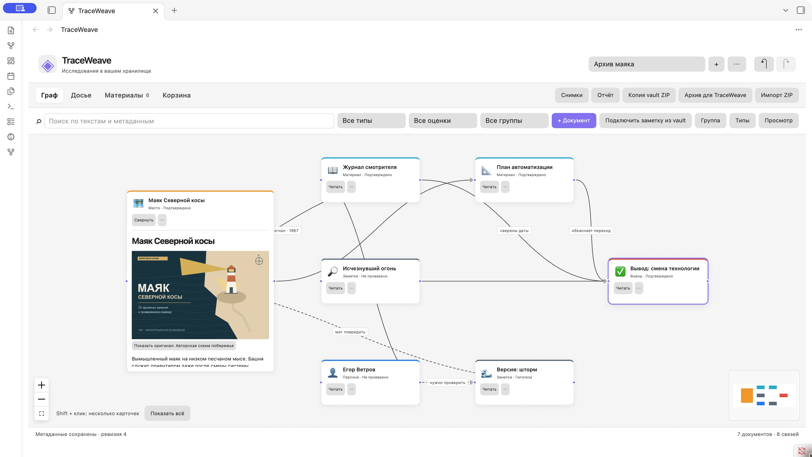
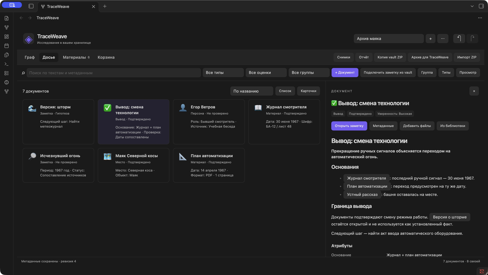
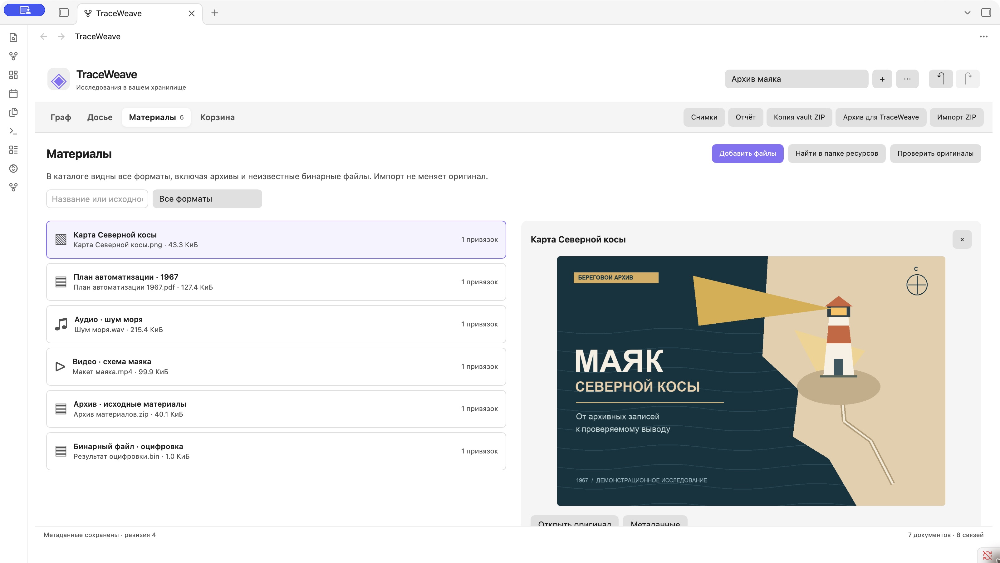

<p align="center">
  
</p>

# TraceWeave для Obsidian

*[English](README.md)*

## Зачем нужен проект

<p align="center">
  
</p>

Исследование растёт в заметках, документах и записях. TraceWeave добавляет к хранилищу Obsidian граф явных отношений: можно проследить источники, отделить гипотезы и вернуться к своим выводам.

Подключайте существующие Markdown-заметки без перемещения, создавайте документы, прикрепляйте изображения, PDF, аудио, видео, архивы и произвольные бинарные файлы. Работайте с графом или досье. Заметки остаются обычными файлами Obsidian. Связи, атрибуты и история собраны в одной скрытой папке `.twdata/`; рядом с заметками нет служебных файлов.

Выше использованы общие иллюстрации TraceWeave, а не скриншоты плагина.

**TraceWeave 0.1.5 поддерживает русский и английский интерфейсы.** Язык автоматически следует настройке Obsidian; изменить его отдельно можно в **Настройки → TraceWeave → Язык интерфейса**. Тексты заметок, подписи связей и пользовательские типы сохраняются без перевода.

## Скриншоты

Реальный интерфейс Obsidian на примере **«Архива маяка»** — вымышленного исследования с синтетическими заметками и вложениями.

**Прослеживайте источники.** Связывайте документы и материалы на графе; пунктирные линии обозначают гипотезы.



**Читайте исследование как досье.** Просматривайте карточки документов, сохраняя контекст исследования.



**Собирайте исходные материалы.** Изображения, PDF, записи, видео и другие прикреплённые файлы доступны в общей библиотеке исследования.



[Все три сцены в светлой и тёмной темах, с русскими и английскими демонстрационными материалами](docs/screenshots/README.md).

## Быстрый старт

**Настольный Obsidian 1.14.4 или новее.** Сервер, Docker, аккаунт TraceWeave и интернет для работы не нужны.

TraceWeave **ещё не включён в каталог Community plugins Obsidian**. Установите опубликованный [выпуск GitHub](https://github.com/andrey-torlopov/TraceWeaveObsidian/releases) через [BRAT](docs/ru/installation.md#установка-через-brat) либо используйте ручной способ из [инструкции установки](docs/ru/installation.md). После одобрения каталога: **Настройки → Сторонние плагины → Обзор → TraceWeave → Установить → Включить**.

1. В палитре команд выполните **TraceWeave: Открыть исследование**.
2. Нажмите **Создать исследование**.
3. Выберите **Подключить заметку из vault** для существующего файла либо **+ Документ** для новой заметки.
4. Соедините две карточки и при необходимости задайте подпись. **Оценка → Гипотеза** делает линию пунктирной.

[Продолжить быстрый старт](docs/ru/quick-start.md).

## Документация

- [Установка, BRAT и обновления](docs/ru/installation.md)
- [Возможности и поддерживаемые файлы](docs/ru/features.md)
- **[Хранение данных, сеть и границы защиты](docs/ru/data-and-security.md)**
- [Резервные копии, отчёты и перенос проектов](docs/ru/backup-import.md)
- [Вся пользовательская документация](docs/ru/index.md)
- [Протокол хранения и миграции](docs/storage.md)
- [Сборка и публикация](docs/publishing.md)

**Резервная копия должна включать `.twdata`. Obsidian Sync исключает эту скрытую папку**, поэтому синхронизация одних заметок не переносит граф. Одновременно записывать данные должен один экземпляр плагина. Импорт ZIP создаёт отдельную копию исследования; обычные wikilinks и относительные Markdown-пути после импорта могут требовать исправления. См. [границы резервного копирования и импорта](docs/ru/backup-import.md).

## Нужна веб-версия?

[TraceWeave web](https://github.com/andrey-torlopov/TraceWeave) можно поднять на своём компьютере или сервере в Docker-контейнерах. Следуйте её [инструкции установки](https://github.com/andrey-torlopov/TraceWeave/blob/main/docs/ru/installation.md). Веб-версия имеет собственное хранилище за пределами vault и другой интерфейс. Проекты передаются явно через поддерживаемый архив TraceWeave; живой синхронизации между приложениями нет.

## Разработка

Используйте диапазон версии Node.js из `package.json`. Из корня репозитория:

```sh
npm ci
npm run generate:validators
npm run lint
npm run typecheck
npm test
npm run package
```

Упаковка собирает bundle, создаёт локальный `release/traceweave-0.1.5.zip` и отдельные файлы в `release/0.1.5/`. GitHub Release содержит только `main.js`, `manifest.json` и `styles.css` с подтверждением происхождения сборки. Пользователю нужны собранные файлы плагина, без Node.js и исходников. Условия использования — в [LICENSE](LICENSE); полные [уведомления лицензий компонентов](THIRD_PARTY_NOTICES.md) включены в `main.js`.

Лицензия собственного кода — [MIT](LICENSE). Для включённых компонентов действуют [их собственные лицензии](THIRD_PARTY_NOTICES.md).
