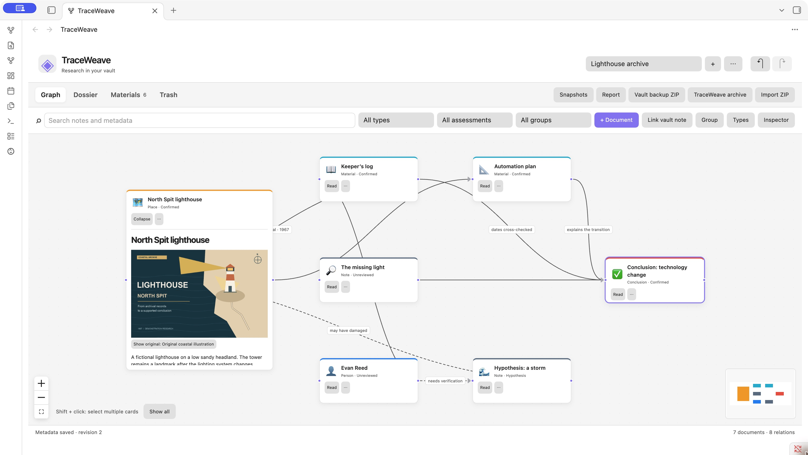
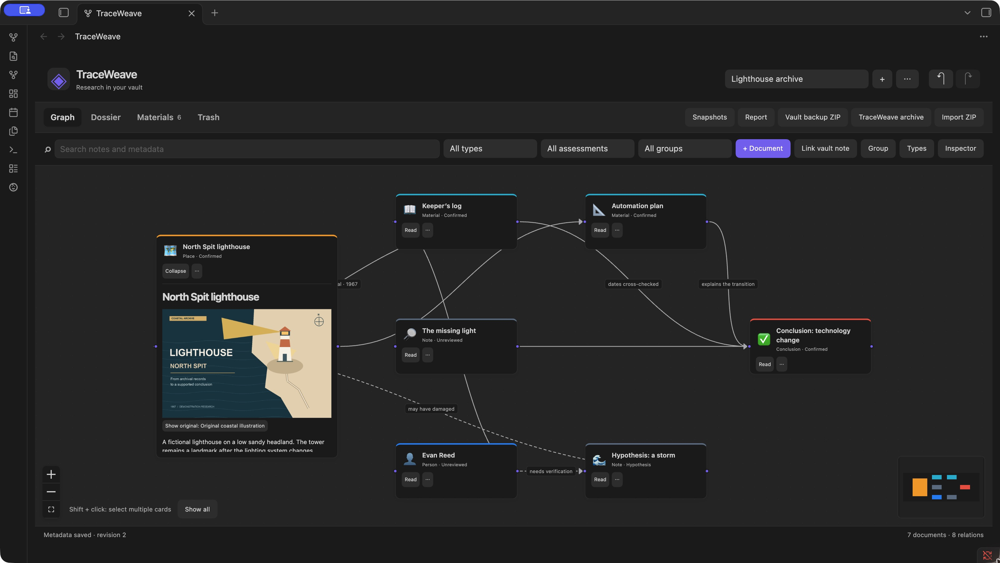
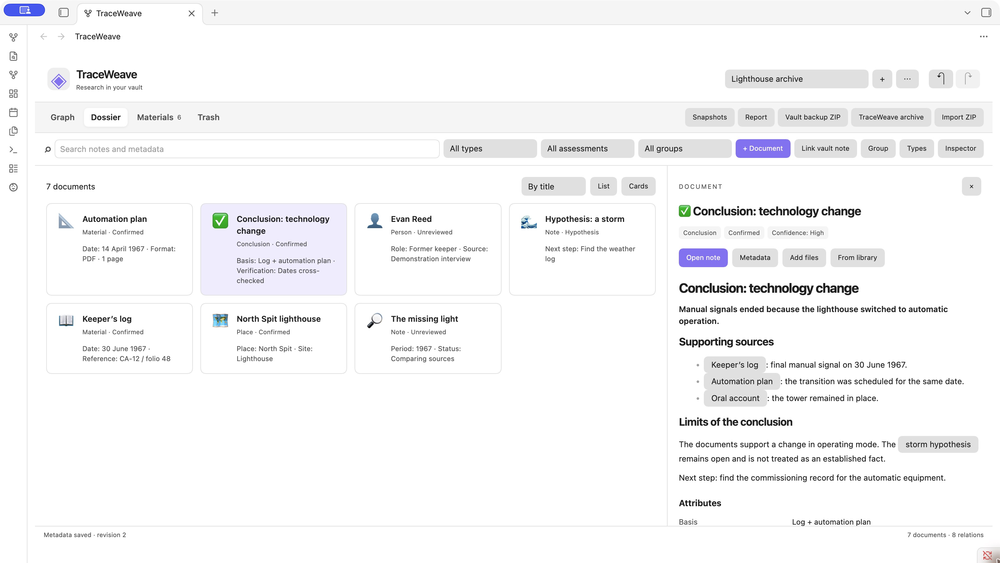
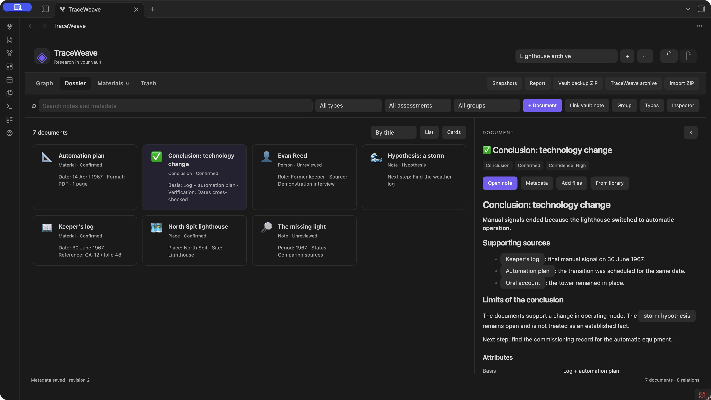
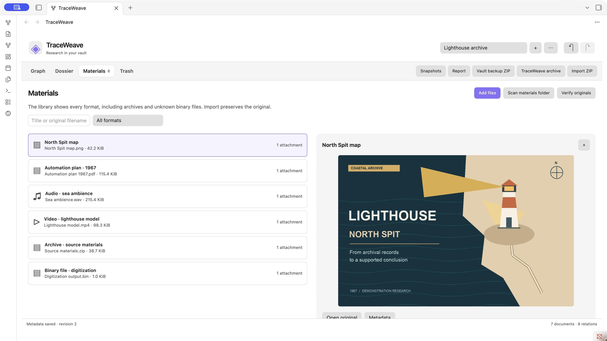
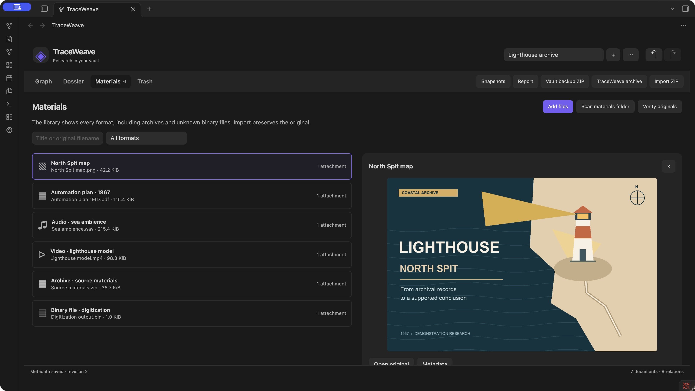
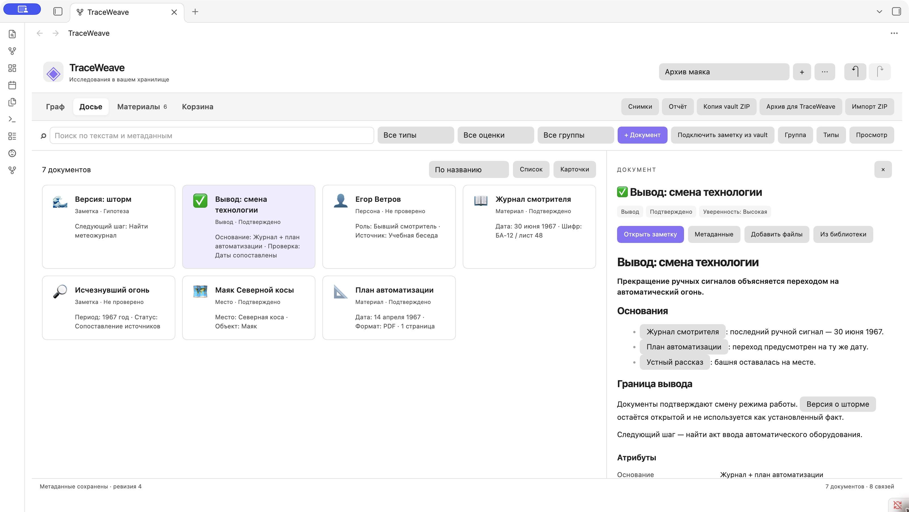
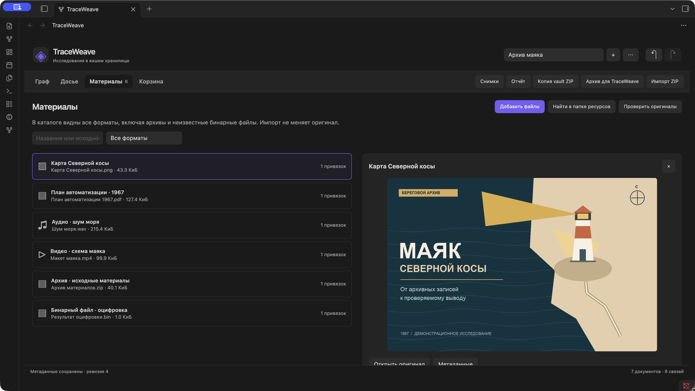

# TraceWeave screenshots / Скриншоты TraceWeave

Real screenshots of TraceWeave **0.1.4** in desktop Obsidian **1.14.4**, using the light and dark themes. **Lighthouse Archive / Архив маяка** is a fictional research project with English and Russian demonstration content. Its notes and attachments were created for these screenshots.

Реальные скриншоты **TraceWeave 0.1.4** в настольном Obsidian **1.14.4**, в светлой и тёмной темах. **Lighthouse Archive / «Архив маяка»** — вымышленное исследование с демонстрационными материалами на английском и русском языках. Заметки и вложения созданы для этих снимков.

These screenshots document 0.1.4. Version 0.2.0 adds the node note chooser, project diagnostics and the visible TWData layout; see the current [quick start](../en/quick-start.md).

Эти снимки показывают 0.1.4. В 0.2.0 добавлены выбор заметки узла, диагностика проекта и видимое расположение TWData; актуальные действия описаны в [быстром старте](../ru/quick-start.md).

## English demonstration content

### Graph

Connect research documents and their sources. A relationship assessed as a hypothesis uses a dashed line; an optional label explains the connection.

| Light | Dark |
| --- | --- |
|  |  |

### Dossier

Browse the same research as document cards and open a note to read its contents.

| Light | Dark |
| --- | --- |
|  |  |

### Materials

Keep attached originals in the research library, including images, PDFs, audio, video, archives and other files. Preview support depends on the file format.

| Light | Dark |
| --- | --- |
|  |  |

## Демонстрационные материалы на русском

### Граф

Связывайте документы исследования с их источниками. Связь с оценкой «Гипотеза» отображается пунктиром; необязательная подпись поясняет отношение.

| Светлая | Тёмная |
| --- | --- |
|  |  |

### Досье

Просматривайте то же исследование в виде карточек документов и открывайте заметки для чтения.

| Светлая | Тёмная |
| --- | --- |
|  |  |

### Материалы

Храните прикреплённые оригиналы в библиотеке исследования: изображения, PDF, аудио, видео, архивы и другие файлы. Возможность просмотра зависит от формата файла.

| Светлая | Тёмная |
| --- | --- |
|  |  |

[English README](../../README.md) · [Русский README](../../README-ru.md)
